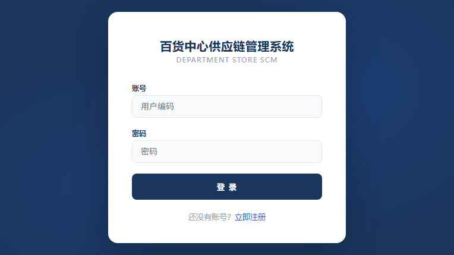
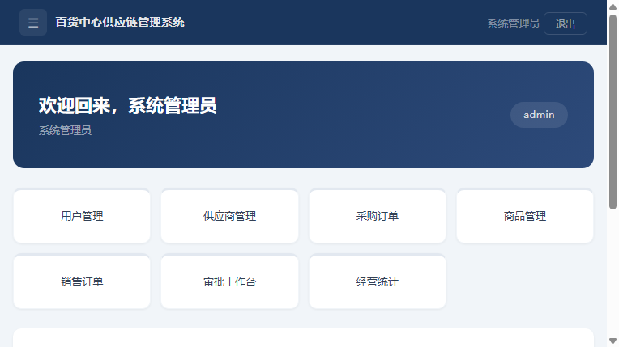
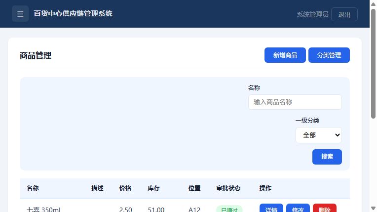
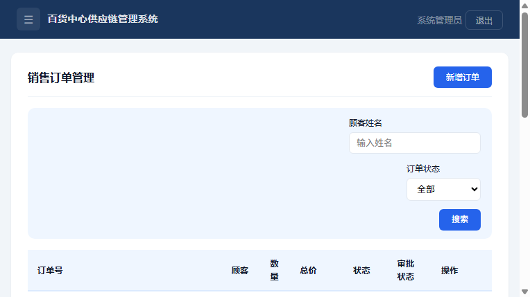
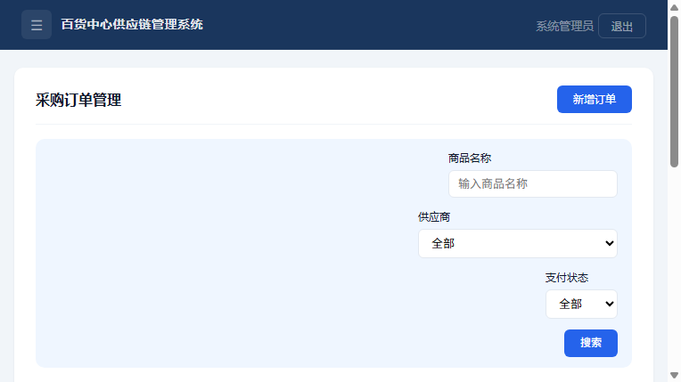
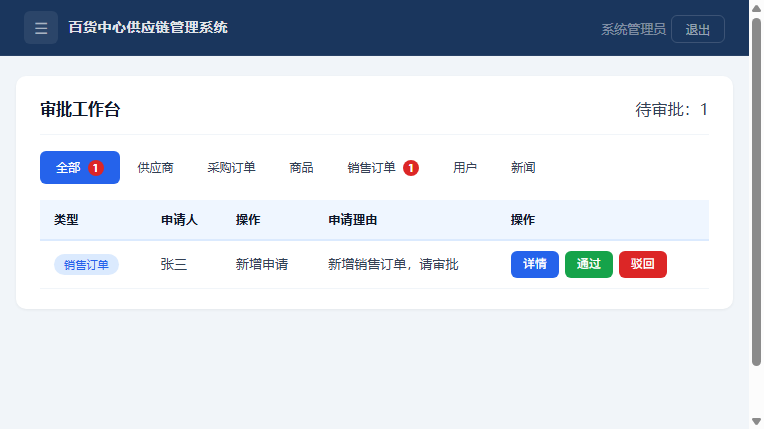
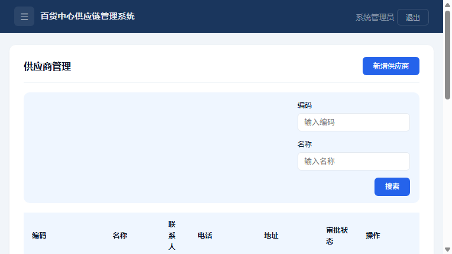
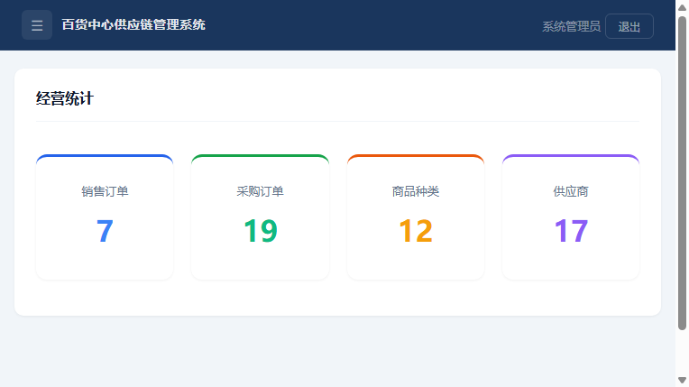

# 百货中心供应链管理系统（进销存）

基于 **Spring MVC + MyBatis + JSP** 的进销存系统，覆盖商品、供应商、采购与销售订单、账单、审批、用户权限、经营统计、新闻资讯，采购申请 → 审批 → 入库 → 结算全流程贯通。

## 规模

| 项 | 数量 |
|---|---|
| 业务模块 | 8 个（商品含类别、供应商、订单、账单、审批、用户权限、经营统计、新闻资讯） |
| JSP 页面 | 40 个 |
| 数据表 | 10 张（`dsscm.sql`） |
| 业务 Controller | 11 个（另有 1 个 BaseController） |
| MyBatis Mapper XML | 10 个 |

## 技术栈

Java 17（编译目标）/ Spring 5.3 / Spring MVC / MyBatis 3.5 / MySQL 8 / JSP + JSTL / Tomcat 9 / Maven（war 包）

## 目录

```
src/main/java/        分层代码：controller / service + impl / dao(Mapper 接口) / pojo / interceptor
src/main/resources/   spring 配置、mybatis 映射、jdbc.properties
src/main/webapp/      WEB-INF/jsp（40 个页面）、静态资源
dsscm.sql             建库建表 + 初始化数据
```

## 运行

1. 建库并导入数据（MySQL 8，端口按本机改 `src/main/resources/jdbc.properties`）：

```bash
mysql -uroot -p -e "CREATE DATABASE dsscm DEFAULT CHARSET utf8mb4;"
mysql -uroot -p dsscm < dsscm.sql
```

2. 打包并部署到 Tomcat 9.x（项目用 `javax.servlet`，Tomcat 10+ 改成了 jakarta 包名，会起不来）：

```bash
mvn clean package -DskipTests
# 把 target/supply-chain.war 丢进 Tomcat 9 的 webapps/
```

3. 浏览器访问 `http://localhost:8080/supply-chain/login`，管理员账号 `admin / 123456`。

数据库密码走环境变量或改 `jdbc.properties`：`jdbc.password=${DB_PASSWORD:123456}`。

## 页面截图

| 登录 | 首页 |
|---|---|
|  |  |

| 商品管理 | 销售订单 |
|---|---|
|  |  |

| 采购订单 | 审批工作台 |
|---|---|
|  |  |

| 供应商 | 经营统计 |
|---|---|
|  |  |

## 验证记录（实机跑过）

- Tomcat 9.0.123 + MySQL 8 + JDK 17 启动，war 部署约 12 秒完成
- 9 个页面逐个请求返回 200：首页、用户、供应商、商品、销售订单、采购订单、新闻、经营统计、审批工作台
- 新增销售订单（主表 + 明细）经页面提交后落库，列表分页显示总数与页数
- 审批通过链路：销售角色提交新增申请 → 立即生成待审批单据（列表可见）且工作台待办 +1 → 管理员通过 → 单据状态置为已通过
- 审批驳回链路：新增申请被驳回 → 待审批单据被删除，工作台待办归零

## 设计要点

- **订单主从表拆分**：`tb_order` + `tb_order_detail`，列表查询只取主表，避免明细字段拖慢分页。订单新增在一个 Service 事务里同时写主表与明细。
- **审批统一建模**：审批单存 `module / action / recordId / detailJson` 四要素。新增申请提交时先生成待审批单据（列表可见），修改与删除申请先把原单据锁为待审批；通过则落库并把单据置为已通过，驳回则新增删除记录、修改删除置为已驳回。新增业务类型只需补一个 module 分支。
- **登录与异常兜底**：Session + 拦截器统一校验，未登录统一跳登录页；异常统一捕获并按页面提示渲染，不把堆栈抛给用户。

> 注：本项目为课程实作项目，本人负责库表设计、审批流（detailJson 暂存 + 通过/驳回状态推进）、登录拦截与页面校验。
